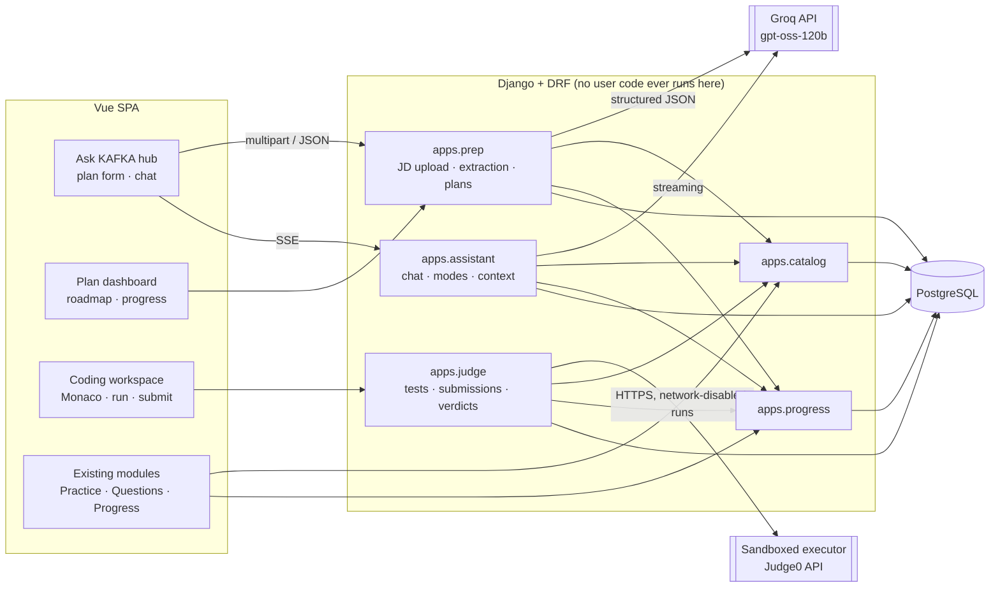
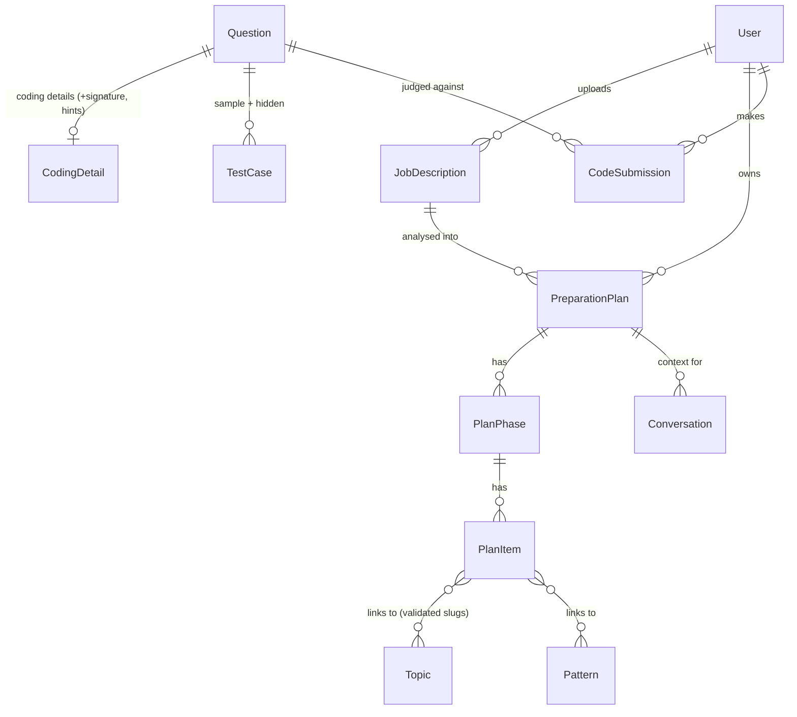
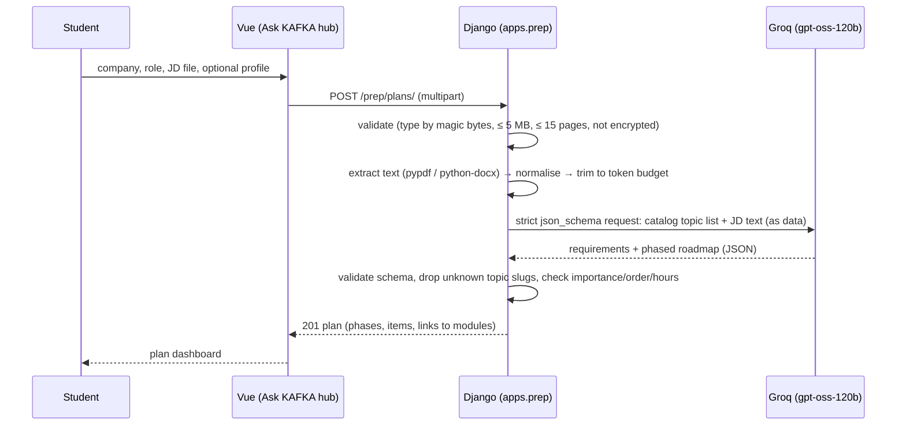

# KAFKA v2 — Architecture & Implementation Plan

Status: **Study plans done (2026-11-15)** — see docs/PROGRESS.md "v2·A". Next: question banks (§6, §7).

> **Changed after review:** the job description is **pasted as text** (no PDF/DOCX upload), so there is no
> `JobDescription` table or file validation — the text lives on `PreparationPlan.job_description`. Plans use
> **low** reasoning effort: measured on Groq's free tier, medium effort can't fit prompt + reply into 8k tokens/min.
Scope source: the v2 brief (personalised preparation, expanded question banks, full integration).

> **Descoped (decided after the plan was written):** the LeetCode-style workspace with real code execution
> (Monaco editor, Run/Submit, sandboxed Judge0 execution, hidden tests, `CodeSubmission`, `apps.judge`) is **out of
> scope for now** — it needs an external sandbox service (a paid/hosted Judge0 key or a Linux server) that isn't
> available. §8 is kept only as a reference design for a possible later version. Coding problems are still expanded
> (§7) with samples and expected outputs, and are practised the way they are today (read, attempt, reveal
> solution, mark done).

---

## 1. What exists today (Phase 1 findings)

| Area | Current state | Reuse in v2 |
|---|---|---|
| Stack | Vue 3 + Vite + Tailwind v4 + Pinia + Axios · Django 6.1 + DRF · PostgreSQL 16 · SimpleJWT (httpOnly refresh cookie) | unchanged |
| Content model | `Category → Topic (→ TopicSection) → Question`; `CodingDetail`, `Solution`, `QuestionOption`, `Pattern` (M2M) | coding problems stay `Question(question_type=coding)`; extend, don't duplicate |
| Question bank | 162 questions — coding 41 over 10 topics (4–5 each), aptitude 61 over 13 topics (4–5 each), core CS 60 | grows to ≥ 650 aptitude and ≥ 210 coding (§6, §7) |
| Content pipeline | Python content modules + idempotent, validating `seed_content` (matches by slug, options by label) | same pipeline; new generators feed it |
| Progress | `QuestionProgress` (state) + `ActivityEvent` (history); summary/plan/insights/streaks computed | coding submissions feed the **same** services (accepted → `mark_completed`) |
| AI | Provider layer (`LLMProvider.stream`) with Groq (default, `openai/gpt-oss-120b`), Claude, fake; question-aware context with anti-spoiler rules; SSE chat; conversations + messages | add a non-streaming `complete_json()`; conversations gain plan context; new `interview` mode |
| Frontend | Design system (Paper/Ink tokens, `components/ui/*`), `useAsync`, `useChat`, SSE client, Practice / Question / Ask KAFKA / Progress pages | Ask KAFKA becomes a hub; new plan + workspace pages reuse components |
| Tests | 114 backend tests incl. an end-to-end journey; providers tested with stubs | every phase adds tests in the same style |
| Tooling | Docker 29.7 installed but **daemon not running**; host is **Apple Silicon (arm64)**; no PDF/DOCX libraries installed | see §8 and §10 |

---

## 2. Target architecture



Two new Django apps; everything else extends existing ones:

| App | Owns |
|---|---|
| `apps.prep` (new) | `JobDescription`, `PreparationPlan`, `PlanPhase`, `PlanItem`; document validation/extraction; roadmap generation and adaptation |
| `apps.judge` (new) | `TestCase`, `CodeSubmission`; executor adapters (Judge0 + fake); language drivers; verdict logic |
| `apps.assistant` (extended) | `Conversation.plan` FK; plan-aware context; `interview` mode; `LLMProvider.complete_json()` |
| `apps.catalog` (extended) | 4 new coding topics; `CodingDetail.signature` + `hints`; content generators |
| `apps.progress` (extended) | coding stats (solved, acceptance rate, by difficulty/pattern) in `insights` |

---

## 3. Data model additions



| Model | Key fields | Notes |
|---|---|---|
| `JobDescription` | user, original_name, file_type (pdf/docx), size, sha256, text, char_count, truncated, created_at | **only extracted text is kept** (decision D-A); file discarded after extraction |
| `PreparationPlan` | user, job_description, company, role, candidate_info, status (ready/failed), summary, requirements (validated JSON: skill, category, importance, evidence quote), days_available, total_hours, model, parent (revision of), created/updated | one row per generated or adapted plan; revisions keep history |
| `PlanPhase` | plan, order, kind (fundamentals / technical / advanced / company / mock-interview), title, goal, est_hours | |
| `PlanItem` | phase, order, title, category, subtopics (JSON list), importance (high/medium/low), reason, activities (JSON list), est_hours, topics (M2M Topic), patterns (M2M Pattern), completed, completed_at | progress lives here; link targets validated against the catalog |
| `Conversation` (+) | plan FK (nullable) | chat keeps the plan's company/role/roadmap in context |
| `CodingDetail` (+) | signature (JSON: function name, typed params, return type), hints (JSON list) | drivers and starter code are generated from the signature |
| `TestCase` | question, input (JSON values), expected (JSON value), is_sample, order | hidden cases never serialised to the client |
| `CodeSubmission` | user, question, language, code, kind (run/submit), status, passed, total, time_ms, memory_kb, compile_output, stderr (truncated), sample_results (JSON, visible cases only), created_at | indexes (user, question, -created_at), (user, status) |

All migrations additive; existing tables untouched except two new `CodingDetail` columns and one nullable FK.

---

## 4. Job description → preparation plan



- **Document handling:** extension *and* magic bytes (`%PDF-`; DOCX = ZIP containing `word/document.xml`),
  size ≤ 5 MB, page cap, encrypted PDFs rejected, no macros executed (python-docx only reads XML), scanned
  image-only PDFs rejected with a clear message (no OCR in v1). Text: whitespace/Unicode normalisation, header/footer
  de-duplication, trimmed to ~10,000 characters (~2.5k tokens) with a visible "trimmed" flag.
- **Not generic:** the prompt requires every requirement to carry an `evidence` quote from the JD; items without
  evidence are rejected by validation. Company/role are inputs — nothing company-specific is hard-coded.
- **Integration by construction:** the model receives the list of real catalog topics/patterns (slug + name) and
  may only link to those; unknown slugs are dropped. Every linked item renders as a button into Practice /
  the coding workspace.
- **Prompt-injection safety:** JD text is wrapped as quoted data with an instruction never to follow instructions
  inside it; output must match the strict schema; nothing from the model is executed.
- **Groq specifics:** structured outputs can't stream, so generation is one non-streaming call (~5–15 s) with a
  loading state. Free tier ≈ 8k tokens/minute: prompt + output are budgeted to fit one call; a second plan within
  the same minute may hit the limit ("try again in a minute").
- **Adapting:** `POST /prep/plans/{id}/adapt {days_available, focus}` creates a revised plan (e.g. "7 days left")
  from the stored requirements, preserving completed items. The chat can recommend this; it never mutates plans
  silently.

## 5. Interactive Ask KAFKA

- Conversations can be attached to a plan; the context adds company, role, top requirements and roadmap
  (compact), plus progress on linked topics. Existing question-aware context and anti-spoiler rules stay.
- New **`interview`** mode: KAFKA runs a mock interview for the plan's role — one question at a time, waits for
  the answer, then gives feedback and a score per answer; ends with a summary.
- "Generate 10 SQL questions" / "teach me OOP" work as chat. Where the bank has matching material, KAFKA is given
  the linked topic list so it can point to it (rendered as links); generated practice problems are labelled as
  unofficial (not executable).

## 6. Aptitude bank → ≥ 50 per topic (13 topics, ≥ 650 total)

Per topic: **20 easy · 20 medium · 10 hard** (existing questions count; difficulties kept).

| Topic group | Method | Correctness guarantee |
|---|---|---|
| Quant (7 topics) | ~8–12 parameterised **templates** per topic (word-problem shapes used in placement tests), exact `Fraction` arithmetic, distractors from typical mistakes | answer recomputed in tests; options distinct; integer-friendly numbers only |
| Number series, coding-decoding, direction sense | rule generators (series rules, ciphers, movement simulation) | verified by re-running the rule / simulation |
| Blood relations | family-tree engine generating statements → relation | relation recomputed from the tree |
| Vocabulary, sentence correction | hand-authored from curated lists (synonym/antonym sets, grammar rules) | reviewed; no generated grammar |

Generators run at **authoring time** and write normal content modules (reviewable diffs); a uniqueness check
rejects duplicate statements/answer sets.

## 7. Coding bank → ≥ 15 per pattern (14 patterns, ≥ 210 total)

- Patterns = topics: the existing 10 plus **Hashing, Sorting, Recursion & Backtracking, Greedy** (new topics).
- Every problem (including the existing 41, which get retrofitted): statement, difficulty, signature, constraints,
  ≥ 2 sample cases, ≥ 8 hidden cases (edge cases + randomised), hints, approach, explanation, Python reference
  solution, complexities, pattern links.
- Expected outputs are produced by the trusted **reference solution at authoring time** (our code, run by a
  content script — never student code) and cross-checked against a brute-force solution where one exists.

## 8. LeetCode-style workspace & secure execution — *deferred, reference only*

Not part of the current build (see the note at the top). Nothing below will be implemented now.

```mermaid
sequenceDiagram
  participant V as Vue workspace
  participant D as Django (apps.judge)
  participant J as Judge0 (sandbox)
  V->>D: POST /judge/run {slug, language, code, custom_input?}
  D->>D: auth · rate limit · size/language checks
  D->>D: build program = student code + generated driver; stdin = sample cases
  D->>J: one submission (network off, CPU/mem/process/file limits)
  J-->>D: stdout · stderr · compile_output · time · memory · status
  D->>D: parse per-case result lines, compare with expected
  D-->>V: per-case actual vs expected (samples only)
  V->>D: POST /judge/submit {slug, language, code}
  D->>J: one submission with all cases (samples + hidden)
  D-->>V: verdict, passed/total, time, memory — hidden inputs never returned
  D->>D: store CodeSubmission; accepted → progress.mark_completed
```

- **Function-stub style (LeetCode-like):** students implement `solve(...)` in Python / Java / C++ / JavaScript.
  The backend generates a per-language **driver** from the problem's signature that reads all cases from stdin,
  calls the function, and prints each result on a marked line. Students' own `print`s still show in the console.
- **One execution per Run/Submit** (all cases batched): keeps hosted quota use at one submission per click.
- **Isolation:** code only ever runs inside the executor's sandbox (Judge0 / isolate): `enable_network=false`
  always, CPU time ≈ 2–5 s, wall ≈ 10 s, memory 256 MB, max processes/threads, max file size; code ≤ 64 KB;
  language allow-list; per-user rate limit; outputs truncated. Hidden cases live only in the DB.
- **Verdicts:** Accepted / Wrong Answer (first failing case number; inputs only for samples) / Compilation
  Error / Runtime Error / Time Limit / Memory / Internal Error.
- **Editor:** Monaco (lazy-loaded on the workspace route only), language selector, per-language starter code,
  draft autosave per problem, console with stdout/stderr, test-results tab, submission history tab.
- **Executor adapter** mirrors the LLM provider layer: `judge0` (works for hosted RapidAPI and self-hosted
  Judge0 — same API) and `fake` (tests). Choice is an env var.

## 9. Integration & progress

- Roadmap items → Practice (filtered topic), coding workspace (pattern problem list), aptitude/core topics.
- Accepted submission → existing `mark_completed`; any run/submit → `record_attempt` → dashboard, streaks,
  plan, insights, focus areas all update with no parallel bookkeeping.
- Coding stats (solved, attempted, acceptance rate, by difficulty and pattern) join `/progress/insights/` and the
  Progress page; plan progress = completed items + linked-topic completion.

## 10. Decisions needed before Phase 3

| # | Decision | Options |
|---|---|---|
| D-A | Uploaded JD storage | keep **extracted text only** (recommended) vs also store files |
| ~~D-B~~ | ~~Execution backend~~ | dropped — code execution descoped |
| ~~D-C~~ | ~~Coding format~~ | dropped — no execution, so no drivers/signatures needed |
| D-D | Aptitude authoring | verified templates + hand-written verbal (recommended) vs fully hand-written |

## 11. Phases (each completed, tested and committed before the next)

| Phase | Deliverable | Verified by |
|---|---|---|
| 3 | `apps.prep`: upload, validation, extraction, `complete_json()` in providers, requirements analysis | unit tests with sample PDF/DOCX fixtures, fake + live Groq call |
| 4 | Roadmap generation/adaptation, plan dashboard, item progress, module links | API tests, browser check |
| 5 | Plan-aware chat, `interview` mode, Ask KAFKA hub UI | tests with fake provider, live Groq check |
| 6 | Aptitude ≥ 650 (20/20/10 per topic) | generator tests: recomputed answers, uniqueness, counts |
| 7 | Coding ≥ 210 (15 per pattern, 4 new topics), each with I/O format, constraints, ≥ 2 samples + expected outputs, hints | expected outputs produced by our reference solutions at authoring time; counts per pattern |
| ~~8~~ | ~~`apps.judge`, Monaco workspace, run/submit~~ | descoped |
| 8 | Plan ↔ modules links everywhere, coding/plan progress in insights | end-to-end journey test extended |
| 9 | Full regression (all tests, build, browser sweep), final deliverables report | — |

## 12. New dependencies & configuration (planned)

| Item | Why |
|---|---|
| `pypdf`, `python-docx` | text extraction (pure-Python readers; no macro execution) |
| `PREP_MAX_UPLOAD_MB`, `PLAN_GENERATE_RATE` | limits |

(Monaco and the Judge0 settings are no longer needed while execution is descoped.)

## 13. Known constraints up front

- Groq free tier (~8k tokens/min, ~1k requests/day, shared by all users) limits how many plans can be generated
  per minute; long JDs are trimmed.
- Scanned (image-only) PDFs can't be read without OCR (not in scope).
- Students can't run code inside KAFKA (execution descoped); coding answers are self-checked against the samples
  and the revealed solution.
